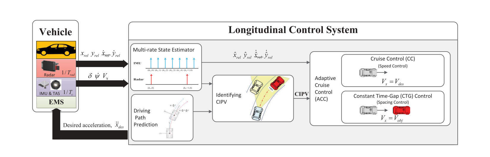

# Vehicle Path Prediction for Adaptive Cruise Control

**Paper review | Yonatan Tamiru Asfaw | Coursework presentation**

A review of **Vehicle Path Prediction Using Yaw Acceleration for Adaptive Cruise Control** by Wonhee Kim, Chang Mook Kang, Young Seop Son, Seung-Hi Lee and Chung Choo Chung (IEEE, 2018).

This assignment involved studying the research paper and presenting its problem, proposed method and reported findings. My contribution is the **14-slide review presentation**. The algorithm, experiments and research results belong to the paper's authors.

## Explore the assignment

| Material | Open |
|---|---|
| My original PowerPoint presentation, including embedded audio | [Download the presentation](https://github.com/yonatantamiru65-tech/vehicle-path-prediction-paper-review/releases/download/coursework-v1/Asfaw_YonatanTamiru_presentation.pptx) |
| Presentation download page | [Coursework release](https://github.com/yonatantamiru65-tech/vehicle-path-prediction-paper-review/releases/tag/coursework-v1) |
| Supplied research paper | [Read the PDF](paper/vehicle-path-prediction-kim-et-al-2018.pdf) |
| Review guide and slide map | [Read the review guide](docs/REVIEW.md) |
| Original publication | [DOI: 10.1109/TITS.2018.2789482](https://doi.org/10.1109/TITS.2018.2789482) |

## What the review covers

ACC must identify the closest vehicle in the ego vehicle's predicted path. A constant yaw-rate predictor can select the wrong target when road curvature changes. The paper studies a predictor that uses **estimated yaw acceleration**, together with a **multirate Kalman filter** for longitudinal control.

*Architecture from Kim et al. (2018), Fig. 1, reproduced in slide 6 of my presentation. The diagram is the paper authors' work.*

| Topic | Focus of the review |
|---|---|
| Path prediction | Constant yaw-rate prediction versus a clothoidal cubic model with changing curvature |
| State estimation | Estimating yaw acceleration without directly differentiating noisy yaw-rate measurements |
| Sensor timing | Combining slower radar measurements with faster IMU/control updates |
| Target selection and control | Closest In-Path Vehicle (CIPV) identification, speed control and spacing control |
| Reported findings | Path-prediction comparisons, lateral error and ACC response figures from the paper |

## Presentation outline

| Slides | Contents |
|---|---|
| 1 | Paper title, research authors and presenter |
| 2-3 | ACC background and the target-selection problem |
| 4-5 | Objectives and claimed novelty of the paper |
| 6-9 | Proposed ACC architecture and methodology |
| 10-12 | Paper results and key observations |
| 13 | Review conclusions |
| 14 | Additional references listed in the original presentation |

The original PPTX is approximately **28.7 MB** and includes embedded audio. It is provided unchanged as a release attachment. Download it and open it in PowerPoint to access its original presentation features.

## Citation and attribution

W. Kim, C. M. Kang, Y. S. Son, S.-H. Lee and C. C. Chung, "Vehicle Path Prediction Using Yaw Acceleration for Adaptive Cruise Control," *IEEE Transactions on Intelligent Transportation Systems*, vol. 19, no. 12, pp. 3818-3829, December 2018. [DOI](https://doi.org/10.1109/TITS.2018.2789482).

A BibTeX entry is provided in [references.bib](references.bib). The publication PDF retains its IEEE copyright notice. Paper figures and research findings remain attributable to the original authors and publisher; no repository-wide software licence is assigned to these materials.

This repository documents a reading and presentation assignment. It contains no implementation, independent reproduction of the experiments or newly measured performance results.
